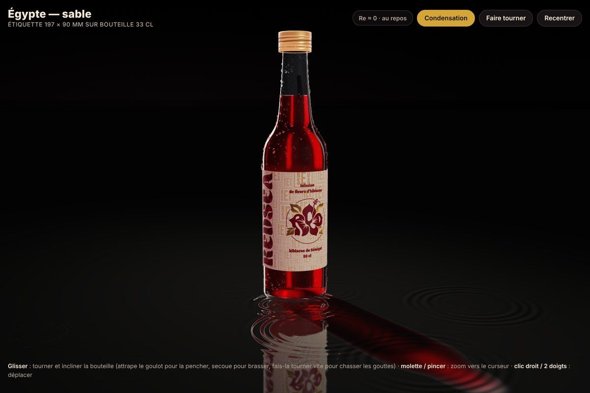

# Simulateur 3D de la bouteille Red Sea

Une page autonome qui montre la bouteille de bissap 33 cl en 3D, avec n'importe quelle étiquette posée dessus. On peut la tourner, la pencher, la secouer : le liquide, la buée et les gouttes réagissent.



Ce dossier contient aussi **toutes les étiquettes Red Sea à plat** (`labels/`), utilisables ailleurs dans le site.

Il est indépendant du reste du site : rien dans `src/` n'en dépend, et il n'utilise pas la bouteille de `src/three/Bottle.ts`.

```
public/simulateur-bouteille/
├── index.html          la page (aucun script ni style dans le HTML)
├── simulateur.css
├── options.js          lit les options d'URL avant le premier affichage
├── simulateur.js       scène, liquide, condensation, galerie d'étiquettes
├── three.min.js        three.js r128 (licence MIT), propre à cette page
├── fonts/              Inter et Bricolage Grotesque (+ licences OFL)
├── labels/
│   ├── manifest.json   la liste des étiquettes
│   └── *.jpg           8 étiquettes à plat, 2364 × 1080 px
├── apercu.jpg          capture pour ce README
└── README.md
```

## L'afficher

```bash
npm run dev
```

Puis ouvrir `http://localhost:4321/simulateur-bouteille/index.html`.

Toujours viser `…/index.html` : les chemins vers `labels/` sont relatifs à ce fichier. La page ne fonctionne pas ouverte en `file://`.

## Compatibilité avec la CSP du site

Le dossier respecte la politique de `vercel.json` telle quelle : aucun script ni style dans le HTML, aucun attribut `style`, aucun CDN, polices et three.js servis depuis le dossier. Vérifié en local avec ces en-têtes : la page complète se charge sans aucune erreur CSP ni requête vers l'extérieur.

**Un lien vers la page marche donc sans rien changer :**

```html
<a href="/simulateur-bouteille/index.html">Voir la bouteille en 3D</a>
```

## L'intégrer en iframe

```html
<iframe src="/simulateur-bouteille/index.html?embed=1&label=egypte-sable"
        title="Bouteille Red Sea en 3D" loading="lazy" class="simulateur"></iframe>
```

**Attention : en production, cette iframe est bloquée par `vercel.json` tel qu'il est** (vérifié en local). Elle marche avec `npm run dev` uniquement parce que les en-têtes n'y sont pas appliqués. Trois règles s'y opposent :

| En-tête actuel | Ce qu'il faudrait |
| --- | --- |
| `frame-src https://challenges.cloudflare.com` | ajouter `'self'` |
| `frame-ancestors 'none'` | `'self'`, pour `/simulateur-bouteille/` seulement |
| `X-Frame-Options: DENY` | `SAMEORIGIN`, pour `/simulateur-bouteille/` seulement |

Une façon de faire : restreindre la règle générale à `"/((?!simulateur-bouteille/).*)"` et ajouter une règle `"/simulateur-bouteille/(.*)"` qui reprend les mêmes en-têtes avec ces deux valeurs changées. Avec ces trois changements, l'iframe se charge (vérifié en local) ; la syntaxe exacte côté Vercel est à contrôler sur un déploiement de préversion. C'est un choix de sécurité : il n'a pas été fait dans ce commit.

### Options d'URL

| Option | Effet |
| --- | --- |
| `embed=1` | Scène seule : pas de panneau d'étiquettes, pas de titre, pas de boutons. |
| `hud=1` | Avec `embed=1` : garde le titre et les boutons (Condensation, Faire tourner, Recentrer). |
| `label=<clé>` | Étiquette affichée à l'arrivée (clé du manifest). Clé inconnue : la première de la liste. |
| `spin=1` | La bouteille tourne toute seule dès l'arrivée. |
| `fog=0` | Sans buée ni gouttes (plus léger pour la carte graphique). |

Sans option, la page s'affiche en entier, avec le panneau qui permet de choisir une étiquette ou d'en déposer une (les images déposées restent dans le navigateur du visiteur, rien n'est envoyé).

### Changer d'étiquette depuis la page qui contient l'iframe

```js
const frame = document.querySelector('iframe.simulateur');
frame.contentWindow.postMessage({ type: 'redsea:label', key: 'momie' }, location.origin);
```

Seules les clés du manifest sont acceptées.

## Les étiquettes

| Clé | Nom | Description |
| --- | --- | --- |
| `egypte-sable` | Égypte — sable | **Version actuelle** |
| `chameau-noir` | Noir — hibiscus rose | Facettes roses + or |
| `turquoise-v3` | Turquoise V3 | Hibiscus + tampon |
| `rouge-tampon` | Rouge — tampon | Bordeaux + mosaïque |
| `illustree` | Illustrée | Personnage qui boit |
| `cleopatre` | Cléopâtre | Illustration |
| `chameau-illu` | Chameau illustré | Illustration |
| `momie` | Momie | Illustration |

- **Format** : étiquette à plat de 197 × 90 mm, en 2364 × 1080 px (12 px/mm). Ce sont des exports pour l'écran, pas les fichiers d'impression.
- **Recouvrement** : les 8 mm de gauche (96 px) sont cachés une fois l'étiquette collée. Pour une texture enroulée sur 360°, comme `public/textures/label.webp`, rogner ces 96 px : il reste 2268 × 1080 px.
- **Passer par `labels/manifest.json`** pour retrouver un fichier, ne pas écrire son nom en dur : le nom porte une empreinte (`egypte-sable-58075fae28.jpg`) qui change à chaque nouvelle version de l'étiquette.

```js
const { labels } = await (await fetch('/simulateur-bouteille/labels/manifest.json')).json();
// labels → [{ key, file, title, sub, … }]   image : `/simulateur-bouteille/labels/${file}`
```

Pour ajouter une étiquette à la main : mettre le JPG dans `labels/` et ajouter `{ "key", "file", "title", "sub" }` au manifest. Les champs `board` et `sha` servent seulement à la synchro avec le template d'étiquettes ; ils sont facultatifs.

## À savoir

- **Page publique une fois déployée** : toute personne qui connaît l'adresse peut ouvrir le simulateur et les 8 étiquettes, y compris celles qui ne sont pas retenues. La page porte `noindex` pour rester hors des moteurs de recherche ; retirer cette balise dans `index.html` si elle doit être référencée.
- **Deux versions de three.js** : le simulateur embarque la r128 (variable globale `THREE`), le site utilise la 0.187 en module. Elles ne se mélangent pas. Le porter sur la version du site est possible, mais c'est une réécriture (gestion des couleurs et shaders à adapter).
- **Gourmand en carte graphique** : la scène est calculée deux fois par image (la vue et son reflet dans l'eau). La page baisse toute seule sa résolution si elle rame. Mieux vaut une seule instance par page, en `loading="lazy"`.
- **Fond noir** : la scène est pensée pour une section sombre.
- **Pas encore mesuré** : la fluidité sur un vrai appareil et le comportement sur téléphone. La page n'a été vérifiée que sur des captures, dans un navigateur sans carte graphique.
- **Bouteille** : Ø 60,1 mm, étiquette posée à 30 mm du fond.

## D'où ça vient

Export du 17/11/2026 du simulateur que Hugo fait évoluer avec Claude ; les étiquettes viennent de son template (dernière synchro le 16/11/2026). Pour changer le simulateur lui-même ou récupérer de nouvelles étiquettes, demander un nouvel export à Hugo : une modification faite directement dans ce dossier serait écrasée au prochain export.
